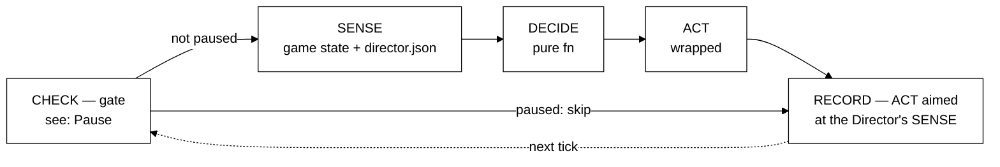
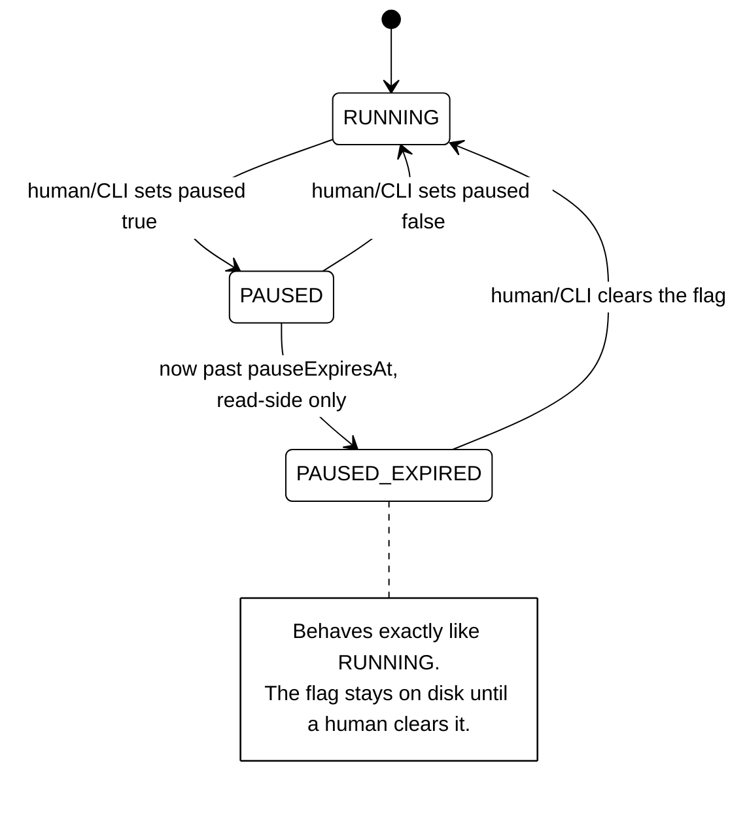

# Strategy — Loop-Based Redesign (Draft)

**Status:** draft, not normative. Intended to replace `strategy.md` once it covers the same
ground and has been reviewed against it; until then `strategy.md` remains authoritative.
**Scope:** how the Director and each domain controller sense, decide, act, and close the loop —
plus the cross-cutting controls (`pause`, and later `advisoryMode`, `disable`) that modulate
them without being loops themselves.
**Assumes:** reader knows `data-contracts.md`'s schemas. This document tells the story and
points into that document for exact fields; it does not restate them.

---

## How this document is organized

Three kinds of thing get documented here, and each gets a different diagram, on purpose:

- **A loop** (an actor: the Director, a domain controller) gets a flow diagram of its own five
  stages — SENSE, DECIDE, ACT, CLOSURE, LEARN — plus a table giving the specifics for that
  actor. The diagram shows the shape; the table shows the mechanism.
- **A control** (a switch that modulates loops without being one: `pause`, `advisoryMode`,
  `disable`) gets exactly one canonical section — usually a small state diagram plus its
  storage/query mechanics — and nothing else. Every loop diagram where that control is checked
  gets only a small marker pointing back here, never a restatement.
- **Anything about what data exists** (not yet used in this document) would get an object or
  data-model diagram instead of either of the above — matched to "what exists and who owns it,"
  not "what happens" or "what state is it in."

If a fact seems to belong in two sections, that's usually a sign it's a control, not evidence
the sections are cut wrong.

---

## Domain Controller — the loop

A domain controller senses, decides, acts, and closes the loop once per tick — and never stops,
even when told to do nothing.

| Stage | Domain controller |
|---|---|
| SENSE | Two channels: live game state (the "is" — e.g. `ns.getServer()`, read fresh each tick) and `director.json` / `control.json` (the "ought" — lease and pause/advisory switches, authored by the Director or a human). The pause check gates everything downstream of it. |
| DECIDE | A pure function of the SENSE snapshot to an action list — no side effects here. Resolves locally for tactics already inside a granted lease; resolves only to a *candidate* — a proposal, not a final choice — when the decision needs Director authority. |
| ACT | Direct (an `ns.exec` against the game) or a message (a state-file write, a candidate publish). Each action wrapped so one failure doesn't kill the loop. |
| CLOSURE | Two paths, different owners, different speeds. Direct-action effects reach *this same* controller's next SENSE in about one tick, through the game world itself. Candidate/lease effects reach it via `director.json`, only after the Director has decided, on the Director's own, slower clock. |
| LEARN | None. `DECIDE` is stateless by design — deliberately absent, not forgotten. Revisit only if drift or tuning ever needs to happen automatically rather than as a human adjusting a constant. |

Reference: `data-contracts.md` Part D (the tick), Part A (the rules a controller must never
violate).

---

## Pause — the first control

Pause is a durable, file-stored switch a controller checks once per tick. It has no existence
outside `control.json`.

| Field | Meaning |
|---|---|
| `controllers.<id>.paused` | the switch |
| `pausedAt` | when it was set |
| `pauseExpiresAt` | `ms` or `null` — `null` never expires, the dangerous case the CLI must surface by default |

Read by every controller, unconditionally, once per tick. Written only by a human or the CLI —
never by a controller, never by the Director. A transient port `PAUSE`/`RESUME` message can
request the same transition but doesn't persist — a nudge at this same state machine, not a
second mechanism.

Reference: `data-contracts.md` §B.4, Part C.

---

## Director — the loop

*Not yet drafted. Next section to build out.*

---

## Open

- `advisoryMode` and `disable` — the other two controls named in `data-contracts.md` §B.2; each
  needs its own canonical section once tested the same way `pause` was.
- The candidate → evaluate → decision flow (a *flow*, not a loop or a control) — diagram type
  not yet chosen.
- How state visibility works without the Director polling directly — likely folds into the
  Director's SENSE once that section exists; may not need a diagram of its own.
